# 七项优先问题修复与 UI 改造

基于 2026-11-05 的[代码检查报告](../code-audit.md)完成 R1、R2、R3、R4、R5、R7、R8。界面采用阅读优先布局，并接入实际 API。此文件记录修复后的状态，原审阅报告保留为修复前基线。

## 已完成的修复

| 项目               | 修改结果                                                                                                                                                 | 验证                                                                               |
| ------------------ | -------------------------------------------------------------------------------------------------------------------------------------------------------- | ---------------------------------------------------------------------------------- |
| R1：配置与分析入口 | 设置页可保存模型、API Key 和配额；导入后可开始分析；项目可选择版本和读取目录、重新分析、查看状态、取消与重试。本地重新分析会从原仓库读取新提交到独立镜像 | 浏览器导入/分析请求链、模型表单测试，项目/API/生成测试                             |
| R2：运行时模型更新 | 新任务和问答即时解析当前配置；已提交生成任务按自身记录的模型配置执行；凭据保存在数据目录的独立 0600 文件，API 不回传密钥                                 | 启动时无配置→保存→立即可用；配置修改后原 handle 保持原值；凭据未进入设置记录或响应 |
| R3：问答与会话     | 正确读取 POST SSE，包括跨字节 UTF-8/CRLF 分帧；处理业务错误、停止生成与断线；会话写入 URL 和本地恢复入口；刷新、切换章节保留会话；引用跟随回答           | DOM 流测试、实际浏览器连续追问与刷新、章节切换                                     |
| R4：跟进队列       | 发现事务提交后唤醒持久队列；启动恢复 queued 行；再次 enqueue 已有 queued 任务也会触发调度；保留事件/任务/游标的落库原子性                                | 无需手工 executeJob 即完成任务；queued 启动恢复；跟进与取消/恢复测试               |
| R5：对比缓存       | 生成缓存包含 kind 和实际 comparisonBaseSha；cache key 升级到 ck2、dedupe key 升级到 dk2，避免新请求复用旧错误结果                                        | 同 head、同 merge-base、不同 base 的缓存隔离；研究缓存、对比与变更测试             |
| R7：代码证据       | 页面与 API 共用来源读取与发布/移除检查；来源深链打开固定版本的代码、文件与行范围；可针对该段代码继续追问                                                 | 服务端深链、浏览器引用→代码→追问、文本转义测试                                     |
| R8：配额与用量     | 生成与问答共用计量入口和并发门；每次 provider 请求前检查配额，成功/失败/取消记录已发起调用；用量带 conversationId                                        | 调用上限为 1 时第二次问答在 provider 请求前拒绝；真实浏览器用量页显示追问计数      |

模型用量优先采用 provider 返回的元数据；缺失时沿用 token 估算，不把估算当作模型账单。本次验证未使用真实模型服务或私有 GitHub 凭据。

## UI 变化

- 项目页保留一个项目列表，按状态显示“配置模型 / 开始分析 / 继续学习”。导入、版本管理与移除按需打开。
- 阅读默认给正文留出空间，目录精简；追问和代码证据共享按需面板。中等宽度下打开面板会收起目录；手机上切换目录、阅读、追问、证据。
- 模型设置可编辑，设置按主题分组，用量表获得完整宽度；术语按中文、英文/符号和来源配对展示；更新记录提供讲解入口。
- 提交显示请求状态与失败原因，防止重复提交；阅读位置自动保存；移除需要依赖加载成功且明确勾选确认。
- 页面导航保留项目，会话和来源可恢复；已移除或不存在的显式项目链接不再静默显示其他项目。

实际浏览器验证了 320、390、768、1024、1280、1440px 的关键阅读/追问布局。检查的窄屏页面宽度未超出视口；临时 viewport 设置已恢复。

### 实际界面

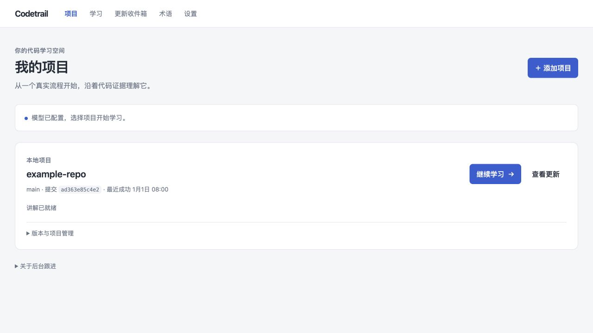

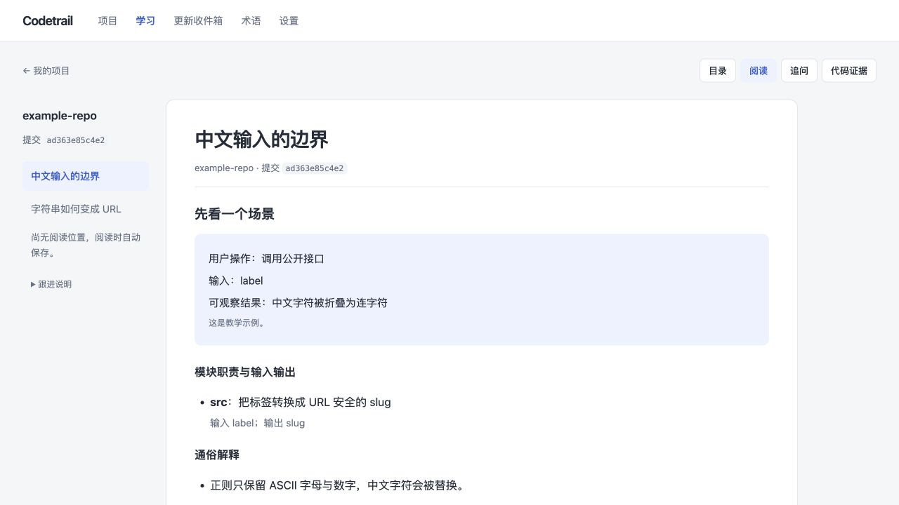

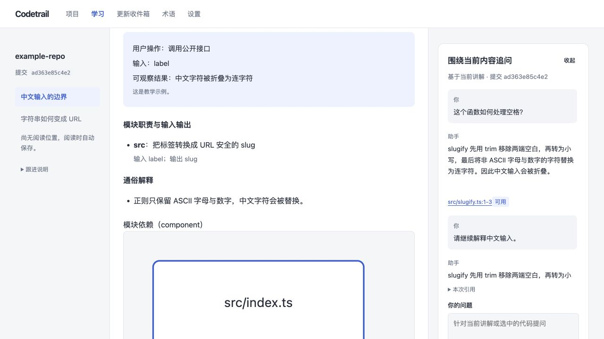

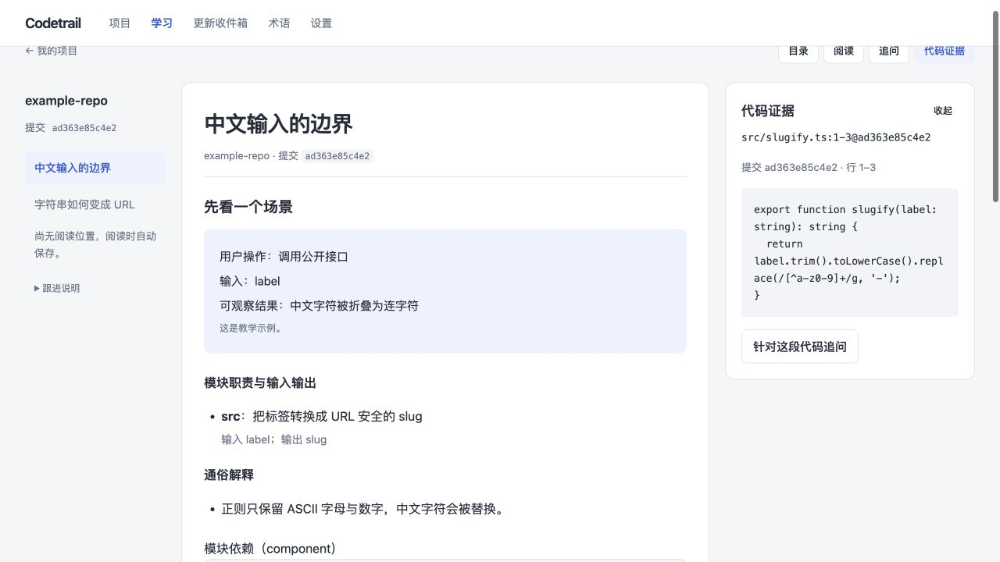

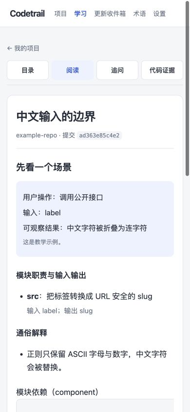

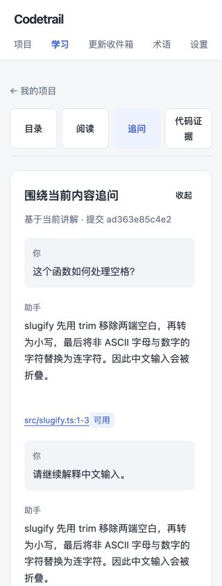

## 验证结果

- TypeScript 类型检查通过：[typecheck.log](typecheck.log)。
- 构建通过：[build.log](build.log)。
- 修改的服务端、浏览器代码与新增回归测试 ESLint 通过：[lint.log](lint.log)。
- 产品回归：**256 个文件通过，1,627 项通过，23 项按阶段测试约定跳过**：[product-tests.log](product-tests.log)。
- 新增 7 项后端回归及 6 项浏览器逻辑回归，另有跟进、缓存、设置和收件箱定向复验：[integration-final.log](integration-final.log)、[client-final.log](client-final.log)。

最终产品回归命令：

```sh
CODETRAIL_PHASE_CHECK=1 node scripts/with-node.mjs node_modules/vitest/vitest.mjs run \
  --config vitest.learning.config.ts --maxWorkers=4 \
  --exclude 'test/learning/fork/**' \
  --exclude 'test/learning/integration/phase-check-b-stage-composition-root.test.ts' \
  --exclude 'test/learning/integration/phase-check-c-stage-ops-suite.test.ts' \
  --exclude 'test/learning/integration/phase-check-gate-registry.test.ts'
```

`CODETRAIL_PHASE_CHECK=1` 使用仓库已有的内部阶段测试模式，跳过递归调用 phase-check CLI 的测试。它保留实际 A/B/C/D 阶段的产品行为测试。五个排除文件属于下面已证实的原有基线问题。

## 完整测试仍存在的原有基线问题

没有把完整测试集宣称为全绿。首次不加排除的完整运行结果为 1,670 通过、23 失败；其中 8 个是本次行为变化涉及的旧 UI、缓存或静止队列断言，已经调整并在后续产品回归中通过。其余 15 个涉及既有 LICENSE/阶段登记及其递归阶段检查连锁失败。

证据见 [baseline-check.json](baseline-check.json)：

- `HEAD:LICENSE` 与当前 LICENSE 的 SHA-256 完全相同，均为 `3fcbc0…`，但 `HEAD:UPSTREAM_BASE.json` 记录的是 `112632…`。本次没有修改 LICENSE 或上游清单。
- `HEAD:scripts/phase-check.mjs` 已注册 D；三个原有 integration 测试仍断言只注册 A/B/C，或 D 为 pending。本次没有通过删除 D 来迎合过时断言。
- phase A/B 的部分外层 CLI 测试因此在前置阶段就失败。

完整首次输出保留于 [full-learning-first-run.log](full-learning-first-run.log)，初轮后端和 UI 失败日志也已保留。没有用缩短输出替代原始失败记录。

## 范围与剩余项

本次完成七项 P1，并在 UI 接线中修复移除确认、阅读状态检查以及同毫秒消息顺序/分页问题。原报告 R6（偏好版本被任务去重绕过）未列入这次七项优先修复，仍需单独处理；`docs/known-issues.md` 的已发布游标与研究讲解扇出限制也仍存在。

旧版生成与历史链接保持可读；ck2/dk2 仅影响新提交的任务和缓存身份，不删除已有生成内容。本次没有改动生成的 OpenWiki 页面。

## 外观与功能说明补充

- 顶部新增“跟随系统 / 日间 / 夜间”，浏览器本地记忆选择，刷新、跨页与跨标签页同步；通过独立的首屏脚本应用配色，继续遵守现有 CSP。
- “查看移除依赖”改为更明确的“移除项目…”。项目移除属于软删除，会停用后台跟进、取消未完成任务；不会删除用户原始代码仓库。本轮没有移除现有项目。
- Anthropic 接入使用 Messages API，包括工具调用。默认访问官方服务；支持通过设置页 Base URL 或启动环境变量 `ANTHROPIC_BASE_URL` 指向兼容网关，目前没有 OpenAI Responses 接入。其他模型是否可用取决于网关的协议兼容性，未进行外部网关实测。
- “自述基础”作为问答上下文的一部分发送给模型，可能受上下文预算截断；当前讲解生成流程没有使用其实际文本。
- 本轮构建、修改文件 ESLint 通过；外观、项目页、客户端及 CSP 定向回归共 5 个文件、30 项通过。浏览器确认日夜配色、刷新与跨页记忆及 390px 无横向溢出。

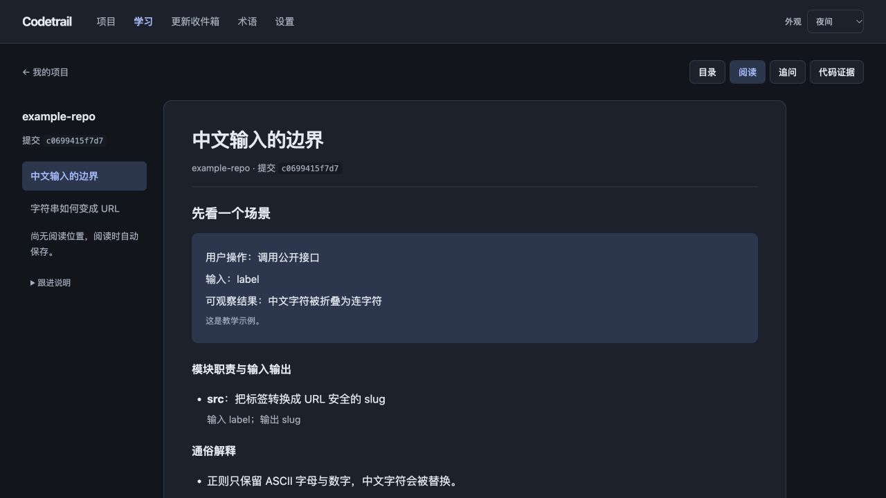

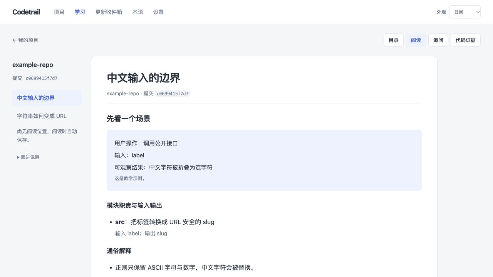

## Base URL 配置补充

- 模型设置新增可选 Base URL，保存后对新任务和后续问答生效。优先级为已保存地址、启动环境变量、官方默认地址；清空输入可移除已保存的覆盖值。填写服务根地址，SDK 自动拼接 `/v1/messages`。
- 地址会进入提交时的模型配置及配置哈希，切换服务不会错误复用另一地址的缓存；已捕获的模型句柄保持原地址。旧配置无此字段仍兼容。
- 校验 HTTP(S) 地址并保留网关的路径前缀，拒绝含账号密码、查询参数或片段的地址；API Key 继续使用独立的本地凭据存储。
- 构建、ESLint 通过；8 个文件、75 项定向回归通过。真实 SDK 向本机模拟网关请求 `/anthropic/v1/messages`，验证根地址、模型 ID 和测试 Key；浏览器验证了保存及刷新回显。记录见 [base-url-tests.log](base-url-tests.log)、[base-url-build.log](base-url-build.log)、[base-url-lint.log](base-url-lint.log)。
- “开始分析”先对选定提交运行项目文档生成，再生成阅读讲解、代码证据和覆盖报告，并发布为本地版本；后续问答按版本检索文档，必要时回退搜索代码，并组装有限上下文。当前研究讲解仍一次仅生成一条 lesson（KI-02），不保证每个模块都得到独立讲解。覆盖报告的 `analyzed` 来自范围分类，不能等同于模型已逐行读完所有文件。

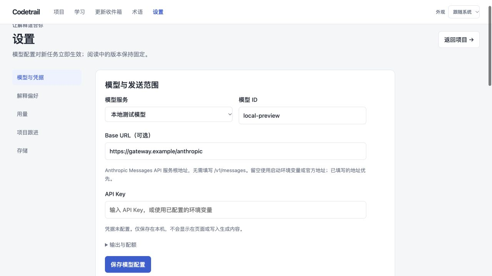

## 模型连接测试补充

- 保存按钮旁新增“测试连接”，使用当前未保存的服务地址、模型 ID 和 Key；Key 留空时复用已保存的本机凭据或启动环境变量。测试不会写入模型设置或凭据文件。
- 新增需要会话认证的 `POST /api/settings/model/test`。通过现有 SDK 发送固定测试文本，输出上限 16 tokens，无自动重试，10 秒超时；不会读取或发送项目代码。仅验证基础 Messages API 调用，不代表已验证完整分析流程及工具调用。
- 前端显示等待状态并防止测试与保存重复提交；成功显示耗时，失败区分认证/权限、接口或模型不存在、限流、请求不兼容、服务异常和超时。返回错误不包含供应商原始响应，防止网关回显凭据。
- 构建及 ESLint 通过；API、模型地址、浏览器逻辑与 CSP 回归共 26 个文件、279 项通过。[完整测试输出](connection-tests.log)、[构建](connection-build.log)、[Lint](connection-lint.log)。
- 浏览器使用隔离的本机模拟服务验证了等待、成功及耗时显示、认证失败和重试可用状态；未使用真实模型 Key 或更改用户项目配置。

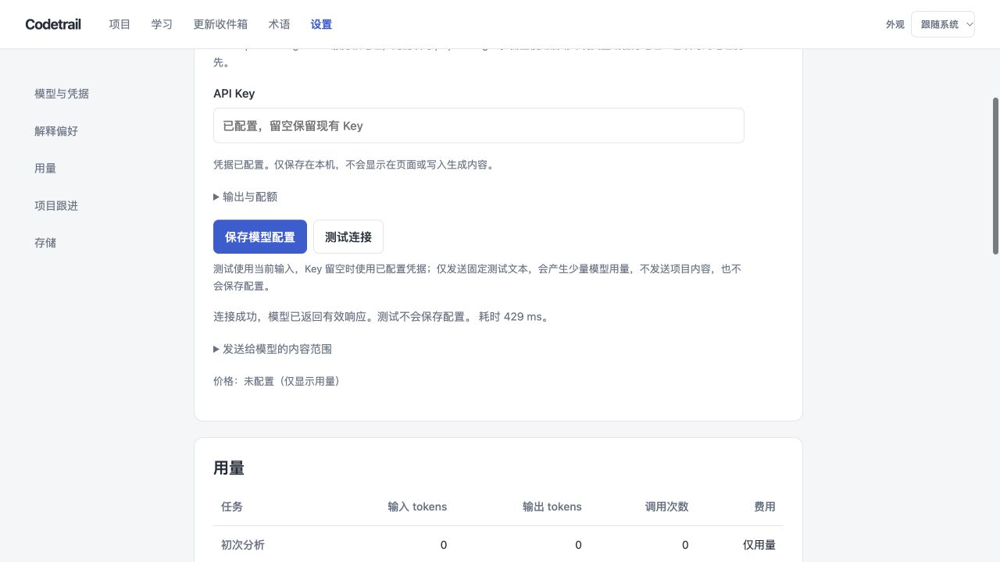

## 连接结果颜色与配置持久化

- 连接成功显示绿色，错误显示红色，日间/夜间采用各自配色；等待和修改输入后恢复中性色。模型设置的保存成功/失败也使用对应颜色。
- 配置仅在“保存模型配置”后持久化：Base URL 和模型 ID 写入数据目录的 `db/codetrail.sqlite`（`app_settings` 表）；API Key 单独写入 `model-credentials.json`，权限 `0600`。默认数据目录为用户主目录下 `.codetrail`，可由 `CODETRAIL_DATA_DIR` 覆盖。使用同一数据目录再次启动即可读取，Key 输入框不回显但会标识已配置，留空保留原 Key。测试连接本身不保存。
- 构建和 ESLint 通过，现有客户端与主题回归共 2 个文件、12 项通过。浏览器使用隔离本机模拟服务验证了日夜模式中的绿色成功、红色错误状态，没有使用真实凭据。

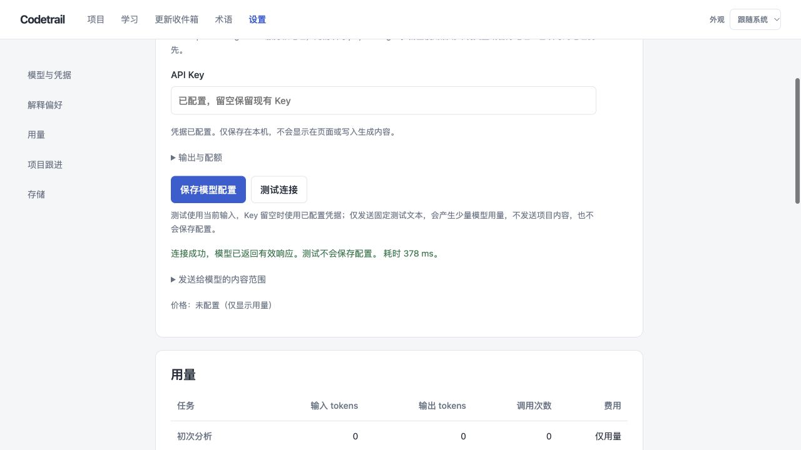

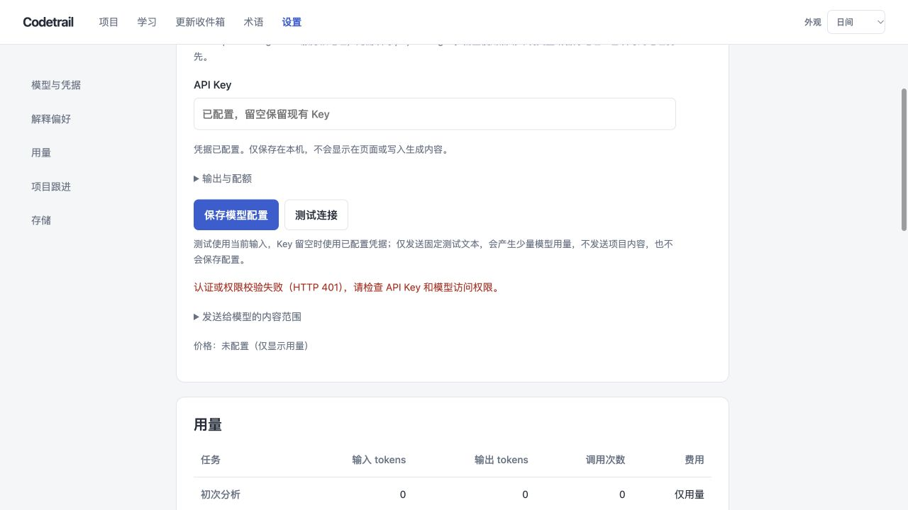

## 分析过程面板第一版

已实现项目卡片摘要、自动打开的右侧/手机全屏面板、阶段和章节计数、活动时间线、耗时、取消/重试及刷新恢复。真实操作中发现的 Git 工作树登记残留也已修复，取消或失败后可正确重试。

最终产品回归 262 个文件、1,663 项通过，23 项按约定跳过，沿用上面已记录的原有基线排除范围。实现说明、测试、限制与界面见 [analysis-progress.md](analysis-progress.md)。

## 规划提交恢复修复

针对实际任务连续失败于 `Repository planning worker exited without submit_plan`，增加保留研究上下文的一次强制定向提交；识别响应截断并在面板显示恢复活动，持续失败时给出中文原因。真实网关工具调用诊断、38 项上游测试及 188 项学习模块测试通过，4320 服务已载入修复。证据、实现范围和验证边界见 [planner-submission.md](planner-submission.md)。

## 分层页面恢复与提交修复

修复父目录不存在时，空页面恢复误把底层 ENOENT 当成致命错误的问题；并给页面写入/提交增加有限的定向恢复。真实 SDK 和文件系统端到端测试验证了截断后写入、Claims 提交和完整清单；当前真实模型也完成了临时小仓库的完整生成校验。108 项上游与 190 项学习模块回归通过。详情及原项目未整仓重跑的验证边界见 [page-submission.md](page-submission.md)。
