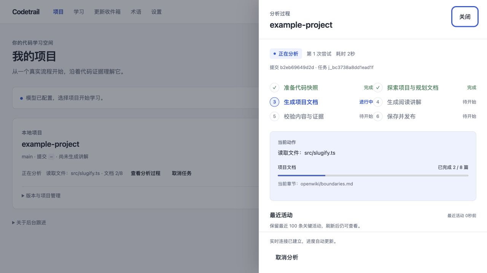
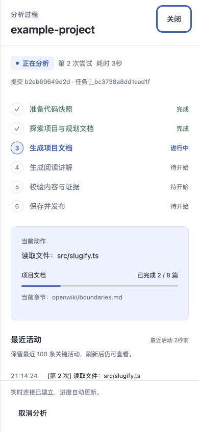
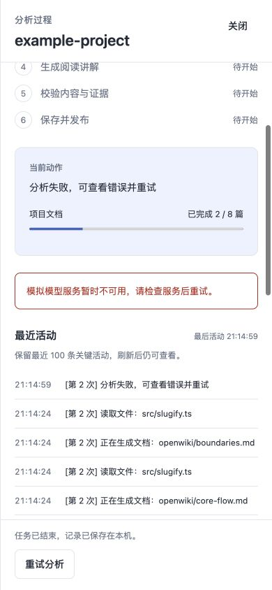
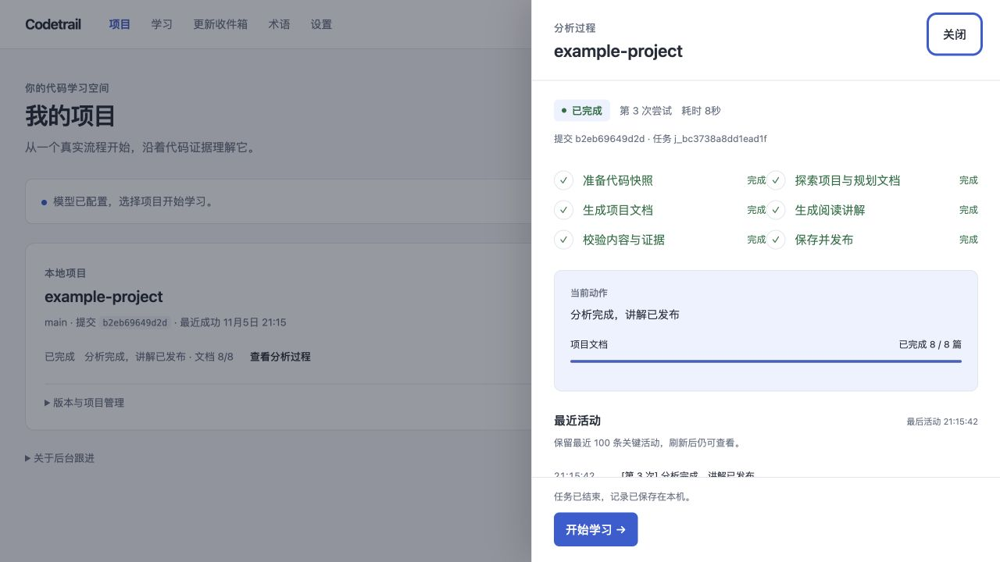

# 分析过程面板：第一版

## 用户行为

- 导入项目并提交分析后自动打开过程面板；已有项目卡片提供“查看分析过程”。URL 的 `job` 参数保留当前选择，刷新后重新读取任务。
- 桌面显示右侧面板，手机使用全屏面板；关闭面板不取消后台任务。
- 显示任务状态、尝试次数、当前提交、耗时、阶段、当前动作、真实文档计数和最近活动。探索阶段没有虚构的整体百分比或预计时间。
- 提供取消、重试和完成后的“开始学习”。失败会标出失败阶段及错误，重试清空当前阶段和计数，并保留之前尝试的活动。
- 断开实时连接会回退到每 2 秒刷新；无法访问服务时保留最后已知的任务状态并显示重连提示，不把网络异常改成任务失败。

## 后台实现

- 准备、规划、文档生成、讲解、检查、封存和发布阶段通过任务执行器统一报告。对比与变更任务也报告其实际阶段。
- 保留底层生成器的页序、总页数和完成数。顺序执行时以一开始计数的 `pageIndex - 1` 表示已完成篇数，最终整理阶段报告总数完成；并发事件优先使用其显式完成数。
- 活动只使用结构化阶段及工具名称/路径摘要，不展示或保存模型自由文本、调试输出、工具完整输入或文件内容。
- 当前进度、递增序号和最近 100 条关键活动存入现有 `jobs.progress_json`，先持久化再通知 SSE 订阅者，无数据库结构迁移；旧任务格式兼容。
- SSE 初始状态携带已有进度；前端监听命名的 `state`、`progress`、`log` 和 `done` 事件，并通过任务接口恢复权威记录。
- 刷新页面不会停止任务。应用重启后，原先正在执行的任务会标为“已中断”，保留过程记录并提供手动重试；没有承诺自动从原步骤续跑。
- 旧任务没有生成过的阶段记录无法补录，会明确显示暂无阶段记录。缓存命中单独显示复用已有结果，避免把跳过的阶段伪装成重新执行。

## 实际操作发现并修复的重试问题

在真实 Git 工作树上，取消后的目录清理会留下 Git 的工作树登记；下一次重试发现目录已经不存在，原实现便跳过清理登记，导致 `worktree add` 拒绝重用该路径。

`ensureBuildWorktree` 现在在创建前清理缺失目录的登记（`git worktree prune --expire now`），保留仍存在的只读快照。新增真实 Git 回归确认同一任务路径可反复重建、未完成输出被清除、原只读快照不受影响。

修复前的完整失败输出：[progress-retry-before.log](progress-retry-before.log)。修复后的项目与取消/重试回归：[progress-retry-tests.log](progress-retry-tests.log)。

## 验证

- 构建通过：[progress-build.log](progress-build.log)。
- 修改的 TypeScript 及新增测试 ESLint 通过：[progress-lint.log](progress-lint.log)。
- 新增 4 项持久化/上游事件回归、3 项浏览器行为回归及 1 项真实 Git 重试回归。
- 初轮相关产品回归 98 个文件、599 项通过；工作树修复后的项目相关回归 22 个文件、132 项通过。
- 最终产品回归 **262 个文件通过，1,663 项通过，23 项按约定跳过**：[progress-final-tests.log](progress-final-tests.log)。沿用 [README 中已证实的原有 LICENSE/阶段登记基线排除范围](README.md#完整测试仍存在的原有基线问题)，不将未排除的完整测试集宣称为全绿。

```sh
CODETRAIL_PHASE_CHECK=1 node scripts/with-node.mjs node_modules/vitest/vitest.mjs run \
  --config vitest.learning.config.ts --maxWorkers=4 \
  --exclude 'test/learning/fork/**' \
  --exclude 'test/learning/integration/phase-check-b-stage-composition-root.test.ts' \
  --exclude 'test/learning/integration/phase-check-c-stage-ops-suite.test.ts' \
  --exclude 'test/learning/integration/phase-check-gate-registry.test.ts'
```

实际浏览器使用临时 Git 仓库和模拟生成器，通过真实任务、HTTP 接口和发布流程验证：自动打开、实时计数、刷新恢复、关闭后任务继续、取消、失败、两次重试、完成后进入阅读页。390px 手机宽度下，页面与面板均无横向溢出；临时视口已恢复。未访问真实模型或修改用户项目数据。

## 界面








