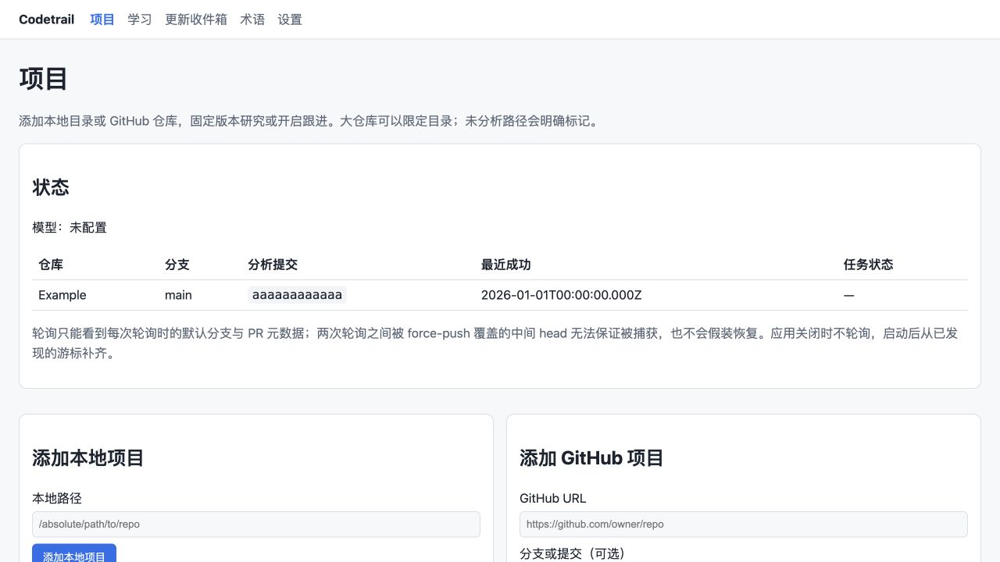
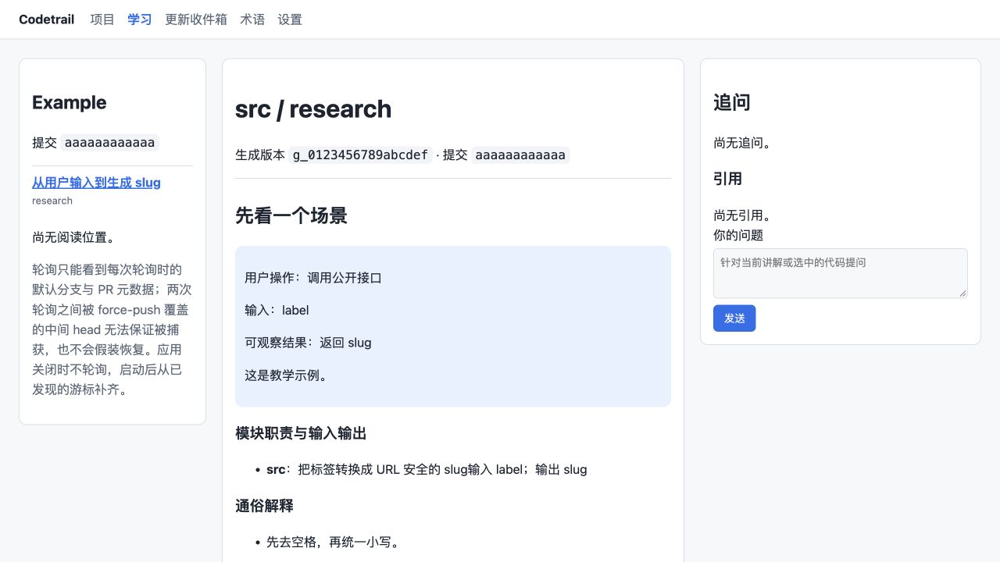
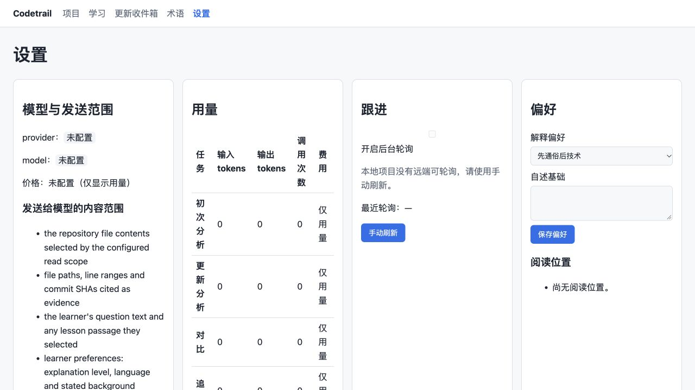

# Codetrail UI 与交互优化方案

日期：2026-11-05。目标用户是希望用中文理解真实项目、阅读基础有限且需要连续追问的个人开发者。方案基于当前源码及实际浏览器检查；页面截图采用临时示例数据。

**建议将产品重心放在“进入一个项目，读懂一个流程，沿着证据继续追问”。** 当前界面按模块和验收项罗列信息，用户却需要自己拼出操作顺序。优先改信息架构与操作闭环，再统一视觉细节。

配套：[代码检查报告](code-audit.md)，包含 10 项已复现问题。对话中另提供两种可点击阅读布局，内容为交互示例，不连接真实生成任务。

## 当前界面的主要问题

| 当前表现                                                     | 对用户的影响                               | 调整方向                                           |
| ------------------------------------------------------------ | ------------------------------------------ | -------------------------------------------------- |
| 首页先给状态表、两个添加表单，再给重复的项目卡片             | 找不到继续学习的主入口，信息重复           | 一个项目列表；每行一个主要操作，添加收进独立流程   |
| “查看移除依赖”是项目卡片唯一按钮                             | 危险且低频的操作比学习更突出               | 主按钮按状态显示开始分析/继续学习；移除放更多菜单  |
| 模型未配置只显示一句状态，设置页也不能配置                   | 用户无路可走                               | 可完成的配置向导，明确下一步                       |
| 三栏固定为 240px + 正文 + 360px                              | 中等宽度下正文被挤压；空问答面板也长期占位 | 阅读优先；追问/证据按需出现，宽屏可选择常驻        |
| 轮询实现限制占据阅读侧栏大段空间                             | 与当前学习任务无关，挤走目录               | 更新页保留一句运行状态，完整边界放可展开说明       |
| 页面标题是 `src / research`，证据展示 sourceId、generationId | 技术内部标识取代了内容含义                 | 使用讲解标题、文件路径和短 SHA；内部 ID 放详情     |
| 设置页把模型、用量、跟进、偏好、存储平铺成网格               | 常见桌面宽度下，用量表被压成竖排           | 分组设置，表格占完整内容宽度；项目跟进移出全局设置 |
| 术语中英文分别成为两列独立长列表                             | 用户要靠位置对齐名称和来源                 | 一行一术语，中英文、解释和来源放在一起             |
| 阅读位置要求编辑数字 offset                                  | 不符合真实阅读行为，也不能自然恢复         | 按章节锚点自动保存、自动恢复                       |
| 收件箱只有摘要、状态、提交信息，条目没有进入讲解的操作       | 即使分析发布也无法顺畅阅读变化             | 每项提供“阅读变更讲解”，展示前后行为及影响模块     |
| 手动刷新对本地项目也出现，但客户端调用 watch API             | 文案承诺操作，实际必然失败                 | 本地用“选择新提交并重新分析”；GitHub 用“检查更新”  |
| 全局导航不保留当前项目，设置/收件箱默认选择第一项目          | 从项目 B 跳到设置后可能操作项目 A          | 应用外壳统一维护并展示当前项目，URL 保留明确上下文 |

### 现状截图

项目页首屏展示了状态、长说明与两个添加表单，项目列表位于更下方。

阅读页的侧栏被轮询说明占据，正文标题使用内部分类，追问空面板固定占位。

设置页在 1280×720 的预览窗口中出现四列，各列宽度不足以承载用量表。

## 建议的信息架构

全局主导航保留 **项目、学习、更新**。术语作为阅读中的辅助面板，同时保留可直接访问的完整术语页；设置放应用工具入口。

进入项目后，顶部始终显示项目名称和当前分析版本。项目内导航对应概览、学习和更新；跟进开关、重新分析、版本选择属于项目操作。模型与凭据、解释偏好、用量和存储属于全局设置。

所有页面共享同一份上下文：project、generation、lesson、conversation、source。URL 是可分享、可恢复的入口；浏览器后退可以关闭来源面板或回到上一篇。明确指定的失效项目或版本显示失效状态，不能静默切换到其他项目。

### 项目页：只回答“我现在能做什么”

一个列表取代状态表与卡片的重复展示。每个项目显示名称、最近学习主题、生成状态、最近成功时间，以及一项主操作。

| 项目状态         | 主要操作   | 次要操作与反馈                         |
| ---------------- | ---------- | -------------------------------------- |
| 未配置模型       | 配置模型   | 显示进入分析所缺的条件                 |
| 已导入，尚未分析 | 开始分析   | 确认分支/提交与读取范围                |
| 分析中           | 查看进度   | 显示真实阶段、耗时，允许取消           |
| 已有讲解         | 继续学习   | 更新数量、重新分析、版本历史           |
| 分析失败         | 重试       | 保留失败原因；若有旧版本，仍可继续阅读 |
| 已移除           | 项目不可用 | 旧链接明确说明，不跳转其他项目         |

“添加项目”点击后再打开导入流程：选择来源 → 确认版本和范围 → 检查模型 → 开始分析。首次使用可以自动进入模型设置；已经配置过的用户跳过这一项。默认分支、排除目录有合理默认值；提交 SHA、目录白名单等高级选项按需展开。

生成期间显示真实阶段，如准备快照、生成知识、编排讲解、校验和发布。后端没有总量时显示阶段和已完成项数，不编造百分比与剩余时间。

### 阅读器：让正文成为主角

推荐默认使用“阅读优先”布局：左侧精简目录，中间正文；右侧只在用户追问或查看证据时打开。另提供“并排追问”布局供连续讨论时使用，并记住选择。

正文首屏控制为：

1. 有意义的讲解标题，如“请求如何进入任务队列”，而不是 `src / research`。
2. 一个具体输入、用户动作与可观察结果。
3. 一张与当前流程相关的小图，节点点击后进入对应证据或讲解。
4. 一至两个关键机制，接着提供深入原理、代码、取舍和边界的展开入口。

代码事实、工程分析和教学示例用简短文本标签区分；不要给所有内容加醒目的胶囊标签。当前提交和覆盖范围保留在紧凑版本条；有缺口时明确标记，并可展开具体路径。不要将缺口隐藏到用户无从发现的位置。

阅读位置按章节锚点自动保存，在返回时恢复；“已读”只表示阅读状态，不推断掌握程度。

### 追问：让上下文和会话状态看得见

- 输入框上方显示“基于：当前讲解 / 选中代码片段 / 当前版本”，选中内容可以清除。
- 新建会话即保存 conversationId；刷新、切换章节和再次进入项目后可恢复。
- 提交后立即展示用户消息，并显示请求中的真实状态。正确消费 POST SSE；业务 error 不得当作成功。
- 回答引用直接出现在相关回答旁，点击打开源码面板，避免把所有历史引用累计在独立长列表里。
- 提供停止生成、失败重试；网络异常保留草稿和已收到内容，防止重复提交。
- 用户切换 generation 时，会话绑定必须同步校验。旧会话仍可查看，需要基于新版本提问时创建新会话，不能把旧版本回答放在新版本标题下。

当前后端以 `invoke()` 得到完整模型答复后再发送文本片段。第一步先把现有 SSE 生命周期接好；若要真正逐 token 显示，需要单独改后端模型调用方式，不能仅做前端打字动画冒充实时生成。

### 证据：一次点击就能验证讲解

点击讲解中的证据、问答引用、图节点或术语来源时，在当前阅读上下文打开同一个来源面板。

面板应显示文件路径、固定提交、行号和高亮代码；同时说明它支持哪条陈述。提供“针对这段代码追问”，携带来源和版本绑定。比较讲解可显示前后版本并排或差异视图，清楚标出 base/head，避免仅展示 head。

`source_removed`、`source_missing`、`version_mismatch` 各有明确状态和返回入口，不能用空白面板代替。

### 更新页：围绕“发生了什么变化”组织

默认查看当前项目，也可明确切换到其他项目。顶部显示跟进开关、真实最近检查时间与“检查更新”。不要从最近变更的 discoveredAt 推导轮询时间：检查没有发现更新，也应推进最近检查时间。

每条变更依次显示标题、一句话行为变化、影响模块和生成状态。已发布条目提供“阅读变更讲解”；分析失败则提供重试；排队与分析状态有实时更新。短记录也可展开原提交，不因简短而失去来源入口。

本地项目提供“选择新提交并重新分析”，使用独立镜像从本地仓库读取新提交。它与 GitHub 检查更新是不同能力，应分别接入对应 API。

### 设置和术语：分组、配对、可操作

全局设置按模型与凭据、解释偏好、用量、存储分组，一次显示一个主要组。模型设置可编辑、验证并明确何时生效；用量表占完整宽度，单位和配额含义清晰。发送范围改成中文摘要，完整列表按需展开。

术语页使用单列表或表格：中文名 / 英文名与代码符号 / 一句解释 / 所属项目和来源。可按当前项目筛选和搜索。阅读中点击术语先展示简短解释，再进入对应证据；不要求用户离开当前讲解才能理解术语。

## 视觉与响应式规范

- 使用一个中性色背景、一种主强调色，危险色只用于破坏性操作和关键错误。一个操作区域只设一个主按钮。
- 用间距和标题建立层级，减少给每个内容块套卡片、边框和大标题。正文建议 16px 左右、舒适行高、约 60–75 个字符的行宽；元信息可以更小，但不替代正文。
- 中文文案统一：`research` 显示“项目讲解”，`comparison` 显示“版本对比”，provider 显示“模型服务”。时间显示为本地可读格式，完整时间放详情。
- 文件路径、行号、短 SHA 是有用的技术上下文；generationId/sourceId 等内部标识只保留在复制或详情入口。
- 为按钮、链接、输入框、复选框分别定义样式。当前 `.panel input` 将 checkbox 也设成 `display:block; width:100%`，应按输入类型限定，防止控件错位。
- 宽屏且正文空间充足时允许常驻追问；中等宽度使用正文加按需面板；窄屏用“目录 / 阅读 / 追问”切换并保留阅读锚点，避免把三个长区域直接堆叠。
- 验证 1440、1280、1024、768、390、320px；正文、代码与设置表格不能把整页撑宽。应依据正文的最小可读宽度确定断点，而不是只在 900px 改一次网格。
- 所有操作可通过键盘完成；图节点选中有明确的视觉和文字反馈。状态使用 `aria-live`，错误靠近相关表单，提交期间禁用重复提交并在 finally 中恢复控件。

## 实现顺序与完成标准

| 批次                | 工作                                                                          | 完成标准                                                                                               |
| ------------------- | ----------------------------------------------------------------------------- | ------------------------------------------------------------------------------------------------------ |
| A：恢复主流程       | 修 R1/R2/R3/R4，补模型配置、分析入口、任务进度与会话恢复；同时修 R5/R8        | 空数据目录下，只用浏览器可完成导入、生成、阅读、三轮连续追问；watch 可自动发布变更；预算和对比版本正确 |
| B：统一读取与上下文 | 共用页面/API 读取服务；处理证据深链、偏好版本、移除状态和项目切换；重做项目页 | 引用能打开正确源码；后退/刷新保持位置；删除与失效链接行为一致；切换项目不误操作其他项目                |
| C：阅读与辅助页面   | 阅读优先布局、响应式、更新详情入口、设置分组、术语配对与自动阅读位置          | 常见桌面与手机宽度均可完成同一任务；低频信息按需展开，正文保持可读                                     |

不必为这次优化立即迁移到新前端框架。可以继续保留服务端渲染，把共用的页面读取/DTO 逻辑从 static.ts 和各路由中抽出；浏览器增强按 API 请求、SSE、项目控制、阅读与问答拆分。若后续交互复杂度明显增加，再根据维护成本决定是否引入组件框架。

建议新增少量真正跨层的浏览器验收流程，而不是继续增加“某 data-testid 存在”的断言：

- 全新用户完成首份讲解。
- 三轮连续问答，刷新后恢复，切章节后上下文正确。
- 从讲解/问答/术语打开同一份固定版本证据。
- 跟进发现变更后由真实 runner 自动发布，排队期间重启仍继续。
- 同 head、同 merge-base、不同 base 的两次对比结果相互隔离。
- 模型与偏好变更对新任务生效；配额耗尽前停止调用；移除未确认不会提交。

这些验收使用临时仓库、脚本模型和独立数据目录即可完成，真实模型质量评估另行安排。
