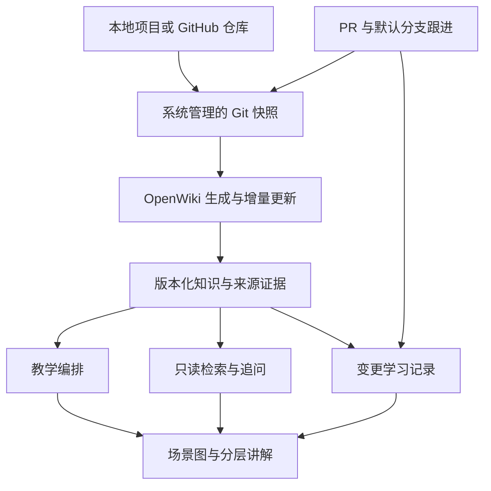

# 基于真实项目的学习系统：实施设计 v0.2

日期：2026-11-01（Asia/Shanghai）  
状态：已完成设计复查，可据此拆分开发任务；尚未开始产品编码或部署，也未证明上游运行兼容性。本文独立于 Last-mile 的项目设计与决策记录。v0.2 取代 v0.1；范围矩阵、处理规则与验收标准共同约束第一版。

## 1. 目标与已确定需求

面向个人使用，通过真实代码理解模块关系、技术机制与技术选择。用户代码阅读基础有限，偏好中文阅读和连续追问；通俗解释与专业术语相连接，图表帮助理解，代码作为可展开的依据。不以求职问答、考试或强制练习为主线。

必须覆盖两个入口：

1. 研究已有项目：自己的项目、他人的公开项目，以及有读取权限的私有仓库。
2. 持续跟进项目：围绕 PR 更新和默认分支新增提交，解释行为变化、相关技术与替代方案。

用户已经认可学习方式，不再安排需求验证轮次。后续安装检查、功能测试和来源核对属于实施质量检查。

默认假设：第一版为单用户本地网页；模型通过可配置 API 调用；本地保存代码快照、生成材料和对话；不要求 Docker、GPU 或公网服务器。本地部署不意味着模型调用不出网，发送给模型的内容范围需在设置中明确。

第一版支持范围固定如下：

| 项目 | 第一版承诺 | 边界 |
| --- | --- | --- |
| 输入 | 本地 Git 仓库、github.com 的公开仓库及有读取权限的私有仓库 | 不接入其他托管平台 API；可将其已有本地 Git clone 作为本地项目导入 |
| 代码版本 | 已提交的 commit、branch、tag；添加时解析成固定 SHA | 不分析未提交/未跟踪文件；界面提示这些内容未纳入，不创建提交或修改用户仓库 |
| 语言 | 优先保证 Python、Java、JavaScript/TypeScript 及 Vue 单文件组件的文本阅读与教学 | 不承诺完备静态调用图；动态注册、反射和框架隐式关系按证据标注推断；其他语言仅提供明确标注的尽力分析 |
| 读取内容 | 范围内的源码、测试、配置、依赖清单、设计文档 | 默认排除密钥、原始数据、模型权重、二进制与依赖/缓存目录；不自动拉取 submodule 或 LFS 大文件；缺失内容显示在覆盖报告中 |
| 部署 | 本机单用户、网页程序运行期间跟进 | 不承诺关闭应用后的通知、云端常驻、多用户权限或跨设备同步 |

本地仓库通过独立对象副本和 detached 分析工作区读取已提交内容，不使用会漏掉本地提交的远端 clone 替代它。导入后按系统项目 ID 管理，凭据不进入模型上下文。

## 2. 底座结论

推荐基于 **langchain-ai/openwiki** 做小范围 fork，保留原有知识生成、来源追踪、增量更新和检索能力，增加独立的学习模块与阅读交互。

核查基线：提交 `7bb583d664f2d1c2484fa44b9d591f6103ca8166`，package.json 版本 `0.7.2`。关键源码已按该提交重新读取，并与本次最初读取的 main 内容对照一致。正式接入固定该提交和依赖锁，升级上游作为单独变更处理。

选择理由：本系统长期成本主要在于代码变化后保持讲解依据可追溯，以及把已有内容用于后续问答。OpenWiki 已经实现这些底层机制，新增工作可集中在教学组织、只读问答、中文检索和变更学习。

不能把 OpenWiki 当作已经完成的学习产品：

- `src/visualize/server.ts` 的路由是阅读器、图数据和重载事件，没有网页问答接口。
- `src/agent/index.ts` 在 `command === "chat"` 时把 `docsOnly` 设为 false；不直接把默认聊天智能体暴露为只读学习接口。
- `src/retrieval/wiki.ts` 使用 FTS5 的 `porter unicode61` 检索。它不等于中文语义召回，第一版需增加中文问题与技术名称之间的映射。
- Claims 记录来源和来源版本。来源存在、版本未变化，不代表对代码语义的解释必然正确；页面不能显示“已证明全部正确”。

## 3. 候选比较与复用方式

| 候选 | 核查内容 | 适合复用的能力 | 对本系统的缺口 | 结论 |
| --- | --- | --- | --- | --- |
| OpenWiki | README、依赖、阅读器路由、检索、生成生命周期、聊天后端与 Claims 类型 | 来源证据、持久化页面任务、增量更新、章节检索、跨仓库工作区、图形阅读 | 教学结构、浏览器问答、变更学习流、中文召回增强 | 主底座 |
| FSoft-AI4Code/CodeWiki | README、增量更新指南、许可证与代码目录 | 依赖图和模块分解；文档描述了组件级更新与传播 | 个性化教学与统一阅读追问还需补充 | 备选；V1 不再同时引入第二套生成引擎 |
| AsyncFuncAI/deepwiki-open | README、目录、问答与 wiki 路由 | 现成网页 wiki、问答流和后台生成任务接口 | 本次所查接口不足以替代 OpenWiki 的逐项来源生命周期；教学与 PR 学习仍需开发 | 如果首要目标改为最快获得现成网页问答，可重新考虑 |
| PocketFlow Tutorial Codebase Knowledge | README、flow.py、nodes.py、许可证 | 六阶段教程流程、初学者解释与章节组织 | 所查主流程偏批量教程生成，长期问答、持久化与增量接入需增加 | 借鉴教学模板，不作为主运行时 |

三个备选核查基线分别为：CodeWiki `80f6cc3942029df6c1c24c611d4f4b443e734e8a`；DeepWiki-Open `cdd19ca055aff4985eeb52e8515774471b967d26`；PocketFlow `05b24cbbb0fe409c5e23c9791f0342f07524ffdc`。未进行完整部署、性能对比或维护质量审计；以上为源码和官方文档支持的选型判断。

已查看的这四个项目许可证均为 MIT。复用源码时保留对应版权和许可文件；依赖许可在实际打包时按锁文件核对。GitDiagram 可作图形交互参考，PR-Agent 可作事件入口参考，V1 不拼接它们的运行服务。

## 4. 第一版产品界面

### 项目入口

添加本地 Git 项目或 GitHub URL；选择固定版本进行研究，或对已关联 github.com 远端的项目开启跟进。显示仓库、分支、实际分析提交、最近成功更新时间和任务状态。大仓库可限定目录；未分析路径明确标记，不表现为完整覆盖。纯本地、未关联 GitHub 的项目支持手动选择新提交重新分析，V1 不监听其文件系统变更。

### 项目阅读

左侧是场景与模块导航，中间是讲解，右侧是围绕当前内容的追问。窄屏改为依次切换阅读与追问。

默认先展示一个具体用户流程、模块之间的输入输出与职责、最关键的一两个技术点。原始代码、深入原理、替代方案和前置基础通过展开或追问进入。展示“运行流程”和“模块依赖”时使用不同图类型。

### 更新收件箱

每个检测到的内容变更都有持久记录：行为前后对比、影响的模块、关键技术、替代方案、证据与尚未验证的效果。格式或文案变更可展示简短记录，仍可展开原提交；不得因模型认为“不重要”而悄悄删除事件。配置、schema 和设计规则的变化不能仅凭后缀当作无行为影响。

### 术语与个人偏好

术语以中英文名称和跨项目链接组织。V1 只保存解释偏好、用户明确反馈的基础和最近阅读位置；“已读”不等于“掌握”，不推断能力分数。

## 5. 架构与模块职责

两条入口共用同一份按版本组织的知识与证据：



1. **项目与快照管理**：把 URL、分支和提交解析为唯一仓库身份；在系统数据目录维护独立镜像和分析工作区。用户原始 checkout 不用于生成写入。
2. **OpenWiki 适配层**：集中包装上游生成、检索、页面读取、Claims 和图数据。上游内部 API 不视为稳定公共 SDK；升级影响限制在该层。
3. **教学编排**：把代码知识与来源组织成场景、职责、机制、术语、取舍、边界和图表。
4. **只读问答**：读取当前页面、所选模块与版本、相关来源和近期对话；按需继续找资料；不拥有代码写入或任意命令执行工具。学习对话状态由扩展层管理，不能顺带继承上游默认聊天后端的工具权限。
5. **变更跟进**：读取远端变化、建立前后版本、关联相关知识，生成学习更新。
6. **本地服务与界面**：项目入口、任务进度、阅读与追问、更新记录；复用上游阅读器和图形逻辑，新增学习 API。

外部技术资料由受限资料读取服务提供，只读官方文档与原始论文，保存内容摘要、版本/检索时间与定位信息；它不拥有本机任意文件读取能力。仓库分析工具限于注册快照，网络资料工具限于可公开访问的资料。读取范围在服务端执行，超出范围的文件、符号链接与跳转不能靠提示词放行。

采用 TypeScript 与现有 Node.js 工具链，避免额外维护 Python 后端。Markdown/JSON 保存可导出的学习内容，SQLite 保存项目索引、任务、对话、游标和个人偏好。第一版无需额外向量数据库、消息队列或独立图数据库。

本机已检查 Node 为 `v22.21.0`，低于该上游声明的 `>=22.22.0`。实际接入时使用独立的兼容 Node 环境，保留当前其他项目环境。

## 6. 两条执行流程

### 研究已有项目

1. 解析仓库和 ref，解析并固定为 commit SHA。
2. 建立系统管理的分析工作区，应用读取范围、排除规则和资源限制。
3. OpenWiki 创建或读取该版本、读取范围和教学配置对应的知识与 Claims；资料不完整时生成覆盖说明。
4. 教学编排提出关键场景，结合测试、配置与设计记录核对模块关系。
5. 生成分层讲解与可点击图表，保留来源定位。
6. 发布通过检查的学习版本；用户可围绕范围内的场景、模块或概念持续追问。库项目没有用户界面时，以“输入—处理—输出”的实际接口为场景；不能虚构界面操作。跨出读取范围的问题先说明覆盖边界，扩大分析范围作为显式任务。

测试代码默认用于阅读和理解边界。不会为了研究陌生仓库自动执行其中的安装脚本、测试或构建脚本。需要实际运行时，作为单独能力增加明确的执行边界。

### 持续跟进项目

1. 第一版由本地后台每五分钟轮询 GitHub 默认分支与 PR 元数据，可手动刷新。应用关闭时不轮询，启动后从已发现游标补齐。首次启用从当前版本建基线，不自动回放全部历史；可手动指定两个可读取的提交回看变化。
2. 默认分支以 first-parent 链上的新增节点建立记录，包括直接提交和 merge commit。合并带入的分支提交作为关联清单，不再次作为默认分支事件逐一推送。若父链不连续或发生 force-push，建立“历史改写/缺口”事件，比较两份可获得的快照，不假装恢复了不可获得的中间版本。
3. PR 记录 `base_head_sha`、`head_sha` 和两者的 `merge_base_sha`；PR 内容差异使用 merge-base → head，预览源码来自 head。它表示提交的分支版本，不代表已经与最新 main 合并后的运行结果。base 分支变化即使 head 不变，也重新判断影响；PR 状态、标题等元数据单独更新，不必全部触发代码重建。
4. PR 列表按 updated 倒序读取并分页，覆盖 open/closed/merged；使用带重叠窗口的时间游标并按事件身份去重，不能只看首页或只看 open PR。default 分支名称变化先记录流切换，再建立新基线。
5. 在同一事务中保存已发现事件、待处理任务和 discovery cursor，随后再进行模型分析。另行保存每条分支/PR 流的 published cursor；只有完整发布后推进。分析失败不会丢事件，也不会让下一轮重复建立相同任务。同一流按顺序处理，前项失败时后项显示等待，可重试；其他流仍可继续。
6. 读取完整 diff，并扩展到相关源码、调用方、测试、配置与已有来源。删除项读取旧版本；相关文件无法读取或比较结果不完整时，记录缺口，不能发布为完整变更解释。
7. 更新受影响知识，再生成“行为变化 + 技术解释 + 其他实现 + 证据与未知”的学习记录，完整发布后推进 published cursor。PR 知识与默认分支知识使用独立发布指针。

代码分析任务去重键为 `repo_id + stream_id + comparison_base_sha + head_sha + base_context_sha + scope_hash + analysis_config_hash`；默认分支的 base context 等于 comparison base，PR 的 base context 等于 base 分支头。相同 SHA 若读取范围或分析配置改变，属于新任务。事件的永久身份与生成尝试分开，重试不创建重复收件箱记录。

PR 合并后始终建立默认分支版本和相应来源记录，再关联已有 PR 讲解。只有可证明相关快照内容和上下文等价时才复用旧讲解；否则生成合并后的补充说明。无法可靠关联 squash/rebase 时宁可保留两条有版本依据的记录，也不错误吞掉变化。“内容相同才复用”不依赖模型的相似度判断。

GitHub compare 接口存在分页与文件列表上限，不能把单次 API 响应当作完整变化。元数据用于发现，完整提交对象和文件差异优先通过系统镜像中的 Git 对象计算；远端历史、fork 权限或网络原因导致对象不可得时显示 pending/error，保留原知识版本。[GitHub 提交 API](https://docs.github.com/en/rest/commits/commits)、[PR API](https://docs.github.com/en/rest/pulls/pulls)。

轮询只保证处理持续可读取的状态，无法保证捕获两次轮询之间被 force-push 覆盖的每个中间 PR head；界面和说明必须明确这一点。V1 的通知范围是应用内更新记录，不包括系统推送、邮件或即时消息。

关闭 watch 停止发现新事件，不悄悄删除已入库记录；已开始的分析任务需通过取消入口停止。失败或取消的任务让同流后继显示等待恢复，`retry` 只接受已停止的 failed/cancelled 任务；不重跑 completed 任务，也不在运行中创建第二个 attempt。

本地轮询先满足 PR/main 的触发需求。若以后需要应用关闭时也实时更新，再添加托管工作进程和 webhook；V1 不要求公网回调地址，不自动向 GitHub 发评论或提交生成材料。

## 7. 教学输出契约

每份讲解包含：

- `context`：仓库、commit、知识生成版本、所选场景和模块。
- `scenario`：具体输入、用户动作和可观察结果；虚构数据标明示例。
- `overview`：模块职责及输入输出。
- `plain_explanation`：先用场景讲机制。
- `technical_explanation`：给出准确术语，并连接上面的例子。
- `choices`：当前做法、真实可比较的替代方案、适用条件与成本。确实没有有价值的替代方案或证据不足时允许为空并说明原因，不能为满足模板编造选择理由。
- `boundaries`：已实现、演示、规划、未知等状态及限制。
- `evidence`：引用仓库证据或外部技术资料的结构化 ID；一般知识引用带版本或检索日期的官方资料。教学示例单独标注，不冒充观测记录。
- `diagram`：节点、边、状态、关联证据或讲解块。

同一份内容不机械重复通俗版与专业版；二者围绕同一个机制递进。初始讲解控制在一个场景与少数关键概念，更深部分按需展开。

陈述分为“代码事实”“有记录的设计理由”“工程分析”“教学示例”。找不到历史决策记录时，不能把工程分析写成作者原意。规划文件不能单独证明功能已经实现。

技术知识分为“项目怎样使用它”和“技术自身怎样实现”。例如仓库只调用 Transformer 库，解释注意力机制时需引用相应官方资料或原始论文，并明确那是技术背景，不伪装成该仓库自主实现。资料服务先从依赖版本与已有官方链接定位资料，必要时受限搜索官方站点或原始论文；不接入登录资料、付费墙绕过或任意网页爬取。检索不到版本匹配资料时说明范围；无资料可读时仍可解释项目事实，背景知识显示来源缺失，不能伪造引用。

## 8. 问答、上下文与中文召回

问答绑定 `repo_id + commit_sha + generation_id`，场景与模块为可选选择项，避免一次回答混用多个版本。V1 跨项目比较限于用户明确选定的两份已发布版本和一个具体问题，不自动汇总所有项目。场景、模块及来源 ID 必须属于所选 generation，由服务端检查。

每轮组装上下文：

1. 当前选中的场景、模块或代码位置。
2. 最近若干轮对话；超出预算后保留带来源标记的摘要与未解问题。
3. 本轮新检索到的相关章节与源码片段。
4. 用户明确确认的解释偏好和基础。

摘要不作为代码事实来源；项目结论仍需回到固定版本证据。切换模块保留同一 generation，追加选择事件；切换代码版本则创建新会话，可携带明确标为历史的摘要，不混用旧版本事实。同一轮生成期间不悄悄换成最新 commit。刷新页面后恢复会话和当前选择；取消的流式回答标注未完成，不进入可靠事实摘要。

中文召回采用“选中位置 + 中英文术语别名 + 上游章节检索 + 按需源码检索”。例如“结构校验 / 数据契约 / schema / Pydantic”，以及“旧快照 / evicted / SnapshotCache”。保留代码符号和路径原文。中文分词或技术术语扩展后再送入 FTS；低命中时用固定快照内的源码搜索补充。语义向量检索保留扩展接口，第一版不强制引入 embedding 服务。

学习问答只开放受限的搜索、页面读取、固定快照源码读取、证据解析和上述公开技术资料读取工具。后台生成材料可以写知识目录，两个执行边界分开；应用负责保存聊天记录，不给问答模型通用数据库写入工具。最大工具调用、输入/输出 token 和整轮预算可配置，耗尽后说明未完成部分，不无限继续检索。

## 9. 证据与图表检查

确定性检查：JSON 结构、仓库与 commit 一致性、引用文件存在、行范围有效、被引片段摘要匹配、图表语法、节点和证据 ID 引用有效。比较类讲解明确标注 before/after 各自来源；不允许“两个提交中的第 40 行”共用一个无版本引用。

模型辅助核对：关键行为判断是否得到片段支持、模块关系是否有调用或数据传递依据、示例是否与真实实现混淆。允许一次定向补查与修正；仍无依据则缩小结论或标记未知。模型核对不是正确性证明。

发布规则：无效结构或越界/不存在的来源 ID 阻止发布；有真实出处但语义支持不足的结论必须删去、降为明确推测或标为未知。空白知识不能发布为成功。某段内容缺少依据时可以发布其余有效内容，但覆盖报告必须列出遗漏，不能宣称分析了整个仓库。问答流中未经检查的内容标记为生成中，最终检查完成才成为完成回答；检查失败保留失败状态和说明。

图表：模块关系用组件图；请求往返用时序图；版本变化用状态图或时间线。节点和边都可绑定来源；推断边标记为推断，规划组件标记规划，演示服务标记演示。第一版使用 Mermaid 与受控节点交互；图像坐标、模型阈值等专用交互按课程需求后续增加。

## 10. 存储、发布与资源

逻辑数据实体：Project、Snapshot、KnowledgeGeneration、Lesson、SourceRef、Conversation、Message、WatchCursor、ChangeEvent、Job、LearnerPreference。偏好与用户自述基础独立于项目事实保存；学习页面读取状态独立于理解程度。

SourceRef 是区分类型的结构：仓库来源包含 `repo_id + commit_sha + path + lines + content_hash`；外部资料包含 `canonical_url + version_or_retrieved_at + locator + content_hash`；教学示例只有示例身份与标签，不伪造来源。固定片段摘要用于检查身份一致性，不等于语义正确。Lesson 与 Conversation 同时绑定 generation。

生成状态为 queued / running / cancelling / completed / failed / cancelled。取消先通知上游与模型调用停止，等待写入退出后才进入 cancelled；失败或取消的 staging 永不切换为当前可读版本。重启后原 running 任务标记 interrupted 失败并提供恢复入口。重试增加 attempt，沿用任务和事件身份；每条流只允许一个写入者。

后台成果先写不可见 staging，检查并封存后，再由 SQLite 事务将 generation、Lesson、事件状态和 published cursor 一起设为可读。不得跨数据库与目录直接宣称一次原子写入：封存失败无事务，事务失败留下可回收的未引用目录。失败不会覆盖旧成果；上游持久化页面任务用于恢复，扩展层另管项目任务与发布状态。

旧 generation 是不可变发布物，问答不在它上面运行任何生成写入。新任务在 staging 工作区接入上一兼容知识基线，重新核对源码版本、页面 manifest、Claims 与恢复状态；不能直接复制上次未完成的 `.run.json` 并假定可移植。该接入是 A 阶段必须实现并测试的适配能力，未作运行验证。适配或来源兼容性不成立时，在剩余预算内全量生成并显示原因，或失败等待处理；不降低来源要求。

生成缓存键包含仓库身份、目标 SHA、PR base context、读取范围与排除规则摘要、模型/生成配置摘要、提示模板版本、偏好版本和上游版本，不包含密钥。发布前后检查源码对象与受控工作树一致；上游设置逻辑若尝试修改受保护源码或配置，适配层必须转移其生成位置或使任务失败，不靠放宽写权限继续。

不自动删除发布版本。V1 提供项目移除和存储用量查看：移除前列出会话、讲解、更新记录的依赖并要求用户确认；被删除来源的旧链接显示不可用，绝不能跳转到最新版本冒充原依据。未发布的孤立 staging 可在没有运行任务引用时回收；完整备份包含 SQLite、发布内容与所需 Git 对象，不包含可重新配置的令牌。

默认后台一个仓库生成任务、一个模型页面工作线程；前台问答保留一个调用槽位，全局最多两个模型请求同时运行，仍受提供方速率限制。记录每项任务的输入/输出 token、调用次数和可获得的实际费用；价格未知时只报告用量，不编造金额。第一版强制限制调用次数和 token 配额，按剩余额度决定能否发起下一次请求；金额预算只在价格已配置时作预估控制，不承诺远端计费的绝对硬上限。取消或断线的在途请求可能已经消耗额度，任务记录保留这部分用量。

联网失败、模型未配置、鉴权失败和限流分别显示；遇到提供方 Retry-After 等待后可重试，达到配置次数即失败，不无限重跑。未配置模型仍可阅读已有内容，新生成任务返回明确配置错误。首次全量分析与日常更新分别计费统计，不承诺未经测量的成本或耗时。

## 11. 实现目录与接口边界

在 fork 内新增 `src/learning/`：

```text
learning/
  projects/       项目身份、快照与读取范围
  upstream/       OpenWiki 内部接口的唯一适配点
  lessons/        教学结构、模板与输出检查
  qa/             只读工具、上下文组装与流式回答
  updates/        PR/main 跟进、去重与变更讲解
  evidence/       固定版本引用与状态映射
  store/          SQLite 与内容索引
  api/            学习用本地 API 和后台任务
```

尽量在新增目录实现；现有 `src/visualize/` 仅增加学习入口、阅读块、所选节点上下文和问答面板。上游检索/Claims 类型的调用集中包装，保留上游测试，不全面重写原生成器。

上游 `beginRepositoryRun` 会调用 `ensureCodeModeRepoSetup`，init 路径还会请求创建 workflow。接入时需要增加可显式关闭仓库设置写入的入口，关闭生成 CI workflow 和修改项目指令文件等附带行为；不能只把生成函数放进后台就视为已完成隔离。上游可复用的是代码与机制，不代表全部默认行为原样启用。

本地接口最小契约如下；路径名可在编码时统一前缀，语义和版本约束不变：

| 接口 | 必需输入 | 约束与结果 |
| --- | --- | --- |
| `POST /projects` | 本地 path 或 GitHub URL，二者择一 | 本地导入是唯一接受绝对路径的注册入口；检查为可读 Git 根目录后分配 ID，不向模型暴露任意目录能力 |
| `POST /projects/:id/analyses` | ref、读取范围、分析配置 | 解析固定 SHA、检查对象可得与模型配置，幂等返回 job ID |
| `GET /jobs/:id`、`GET /jobs/:id/events` | 已知 job ID | 返回状态和进度；事件仅用于展示，重连以持久状态为准 |
| `POST /jobs/:id/cancel`、`POST /jobs/:id/retry` | 已知 job ID | 状态幂等；取消与重试不能产生双写者 |
| `GET /generations/:id/lessons`、`GET /generations/:id/sources/:source_id` | 已发布 generation 和属于它的注册来源 ID | 服务端检查归属；接口不接受任意文件路径或任意外部 URL |
| `POST /conversations` | `generation_ids`（单项目恰好 1 个，比较恰好 2 个），可选场景/模块 ID | 所选内容必须属于对应版本；会话创建后不改变版本集合 |
| `POST /conversations/:id/messages` | 用户文本、可选同版本选择 ID | 校验上下文所有权，返回流式回答；不允许客户端直接指定工具或执行路径 |
| `PUT /projects/:id/watch`、`GET /projects/:id/changes` | 跟进开关/范围；分页游标 | watch 仅适用于已授权 GitHub 关联；事件可分页，无自动 GitHub 评论或写入 |

未发布/未知 ID、版本不匹配、路径越界、缺少模型、对象不可读取和预算不足返回结构化错误码；不能用空白成功页代替。手动重试相同输入关联原任务，新配置创建新分析任务。

API 配置与令牌仅在后端使用；用户源码和第三方仓库内容均按资料处理，不将仓库中要求联网、执行命令或泄露信息的文本当作系统指令。生成的 Markdown 与图表按受限内容渲染，不执行任意脚本。实际写入只发生在系统管理的数据目录与生成材料目录。

服务只绑定 loopback，检查 Host/Origin，并使用本地会话凭证；不能因为部署在本机就允许任意网页读取源码或触发模型调用。外部资料读取拒绝私网/本机地址和越界重定向。默认关闭上游匿名遥测与可选远程 tracing；模型调用所需内容出网单独明确展示，凭据不放入前端、生成材料、日志或备份。

## 12. 实施顺序与完成标准

| 阶段 | 工作包 | 完成标准 |
| --- | --- | --- |
| A 底座接入 | A1 固定 fork 和独立 Node；A2 保持上游检查；A3 管理快照、限制设置写入并适配知识基线；A4 任务、恢复与封存发布 | 可从固定 SHA 创建知识；源码未被修改；跨版本基线可复用或明确全量回退；中断可恢复；失败不覆盖已有版本 |
| B 阅读与追问 | B1 教学契约与模板；B2 场景图/模块图和分层阅读；B3 中文检索、源码与外部资料工具；B4 只读流式问答和会话记录 | 中文阅读与连续追问可用；格式与来源检查通过；刷新保留会话；无依据内容被标注；问答无代码写入工具 |
| C 持续跟进 | C1 main/PR 分页轮询与双游标；C2 完整前后版本与相关代码；C3 更新学习记录；C4 合并关联、缺口、重试与去重 | 第 6 节规定的可观测事件均有记录；重复事件无重复任务；失败保留事件；不同流独立；main 与 PR 预览分开 |
| D 第一版交付 | D1 来源与内容回归；D2 版本漂移、中文问答与 API 负面用例；D3 用量、取消、错误展示；D4 本地启动、存储移除和备份说明 | 两条用户流程均可端到端完成；下面的验收用例通过并留下结果；已知缺陷明确记录 |

A → B → C → D 为实施顺序；C 属于第一版，不无限后移。每个阶段的检查用于保证实现正确，不重新进行用户需求验证。

关键回归案例：

1. Last-mile：旧快照淘汰时，不构造 Approve、不提交决策；旧快照仍在时保留原建议身份。问答必须区分页面行为、Mock 行为与 D-057/D-063 的正式设计。
2. 编号格式合法但对象不存在：解释必须区分 schema 与业务检查。
3. PR 修改了调用方、删掉字段或重命名模块：相关讲解必须更新或明确标记过期；引用不得指向不存在的行。
4. 相同事件重复送达、PR squash 合并、跟进中断后恢复：不丢记录、不错误合并不同内容。
5. 切换提交后追问“这里为什么这样做”：不能混用上一版本证据。
6. 中文问题与英文标识混合：可从“旧快照丢了”关联到 `SnapshotCache`；可从模块名定位源码。
7. 项目文档描述未来功能：不能当作当前代码已实现；引用存在但不支持结论时必须修正或标记未知。
8. 外部仓库文本要求执行命令：学习流程不执行；生成内容不允许任意脚本。

补充实施验收：

9. 本地仓库含未推送提交、未提交修改和未跟踪文件：能分析已选本地 commit；后两者明确排除；原工作区和分析源码不被修改。
10. init 与 update 两种入口均不能生成 CI workflow 或修改被分析项目的指令文件；跨工作区接入基线发生状态不兼容时，预算允许才全量回退并展示原因。
11. 一次轮询发现多个默认分支节点、超过一页 PR 或大 diff：没有首页截断造成的静默漏记；不可读取的历史建立缺口记录；PR base 变而 head 不变仍重新判定影响。
12. discovery cursor 已推进但生成失败/进程退出：事件仍存在，可用同任务恢复；同流后续等待，其他流可继续；不存在双写或完成前推进 published cursor。
13. 文件封存完成但数据库事务前后分别崩溃：重启后只暴露完整旧版或完整新版，不出现新讲解配旧来源。
14. 取消/预算耗尽/限流/凭据缺失：状态、已消耗用量和可重试范围明确；取消后 staging 不发布；错误不会被记录成成功回答。
15. 仓库来源、外部资料和教学示例按不同结构校验；外部资料不可得时不编造引用；不存在的 SourceRef、跨会话 generation ID、越界路径与非本机会话请求被拒绝。
16. 两个版本分别有相同路径和行号：before/after 正确区分；切换版本建立新会话；来源移除后旧链接显示不可用且不改指向最新版。
17. 教学样例包含宏观模块关系和微观技术机制：通俗解释与专业术语指向同一个例子；有记录的选择理由与工程分析分开；无有效替代方案时允许明确留空；用户自述基础和已读状态分别保存。

上述用例要在实现阶段形成可重复检查：版本、状态机、权限、游标和引用约束使用自动化集成测试；教学语义使用固定样例逐项核对事实、分析、示例与未知标签。模型辅助检查不能代替这些约束测试。文档修订本身不表示这些产品测试已经执行。

第一版暂不包含多人协作、考试/掌握度评分、自动修改业务代码、自动评论 PR、任意仓库代码执行、专用 Transformer 动画编辑器或完整跨项目知识图谱。

## 13. 仍可调整但不阻塞设计的事项

- 正式产品名称、独立仓库位置。
- 使用哪个模型 API 与月度预算；接口先支持可配置提供方，价格和能力在接入时核实。
- 后续是否需要云端常驻与跨设备同步。

当前方案按本地单用户实施，不依赖上述事项先做选择才能开始底座接入。发起首个模型任务前必须配置可用提供方与用量限制；没有凭据不阻塞界面和存储开发，但会阻塞实际生成能力的验收。

## 14. 需求与实施覆盖矩阵

| ID | 用户功能或必要边界 | 实施位置 | 验收依据（第 12 节用例编号） |
| --- | --- | --- | --- |
| F01 | 研究自己的、他人的、已授权私有项目 | A：项目身份、Git 快照与读取范围 | 9、15；另以一个公开仓库和一个授权私有仓库完成导入 |
| F02 | 从场景理解宏观模块关系 | B：教学编排、模块/流程图 | 1、7、17 |
| F03 | 深入 schema、模型等具体机制与基础知识 | B：源码证据和外部技术资料 | 2、15、17 |
| F04 | 中文通俗解释、专业术语及可点击图表 | B：分层阅读、中文检索、节点上下文 | 6、17；检查图中来源跳转与当前版本一致 |
| F05 | 阅读后连续追问与刷新恢复 | B：固定版本会话和上下文组装 | 5、14、16；刷新后恢复同一会话 |
| F06 | PR 和默认分支持续跟进 | C：分页轮询、双游标、变更记录 | 3、4、11、12 |
| F07 | 技术选择与替代方案、已实现与规划边界 | B/C：输出契约及内容核对 | 1、7、17 |
| F08 | 个人偏好与跨项目技术联系 | B：独立偏好、术语链接、双版本显式比较 | 16、17；比较时两仓库来源分别可追溯 |
| F09 | 学习入口不改项目代码或附带设置 | A/B：上游设置开关、工具与路径边界 | 8、9、10、15 |
| F10 | 失败、取消、版本发布与资源边界明确 | A/D：状态机、发布事务、用量与错误 | 12、13、14、16 |

全部 F01—F10 属于 V1；完成不能只以“某页面能打开”或“模型返回了文字”为准。第三方功能核查仍是静态选型依据，不代替这些端到端验收。

## 15. 一手来源

- [OpenWiki README](https://github.com/langchain-ai/openwiki/blob/7bb583d664f2d1c2484fa44b9d591f6103ca8166/README.md)：生成、更新、Claims、检索、跨仓库工作区与可视化。
- [OpenWiki package.json](https://github.com/langchain-ai/openwiki/blob/7bb583d664f2d1c2484fa44b9d591f6103ca8166/package.json)：版本、Node 要求与工具链。
- [OpenWiki visualizer server](https://github.com/langchain-ai/openwiki/blob/7bb583d664f2d1c2484fa44b9d591f6103ca8166/src/visualize/server.ts)：现有图形阅读路由边界。
- [OpenWiki wiki retrieval](https://github.com/langchain-ai/openwiki/blob/7bb583d664f2d1c2484fa44b9d591f6103ca8166/src/retrieval/wiki.ts)：章节读取、跨仓库检索和 FTS5。
- [OpenWiki agent](https://github.com/langchain-ai/openwiki/blob/7bb583d664f2d1c2484fa44b9d591f6103ca8166/src/agent/index.ts)：聊天后端与生成接口。
- [OpenWiki backend](https://github.com/langchain-ai/openwiki/blob/7bb583d664f2d1c2484fa44b9d591f6103ca8166/src/agent/docs-only-backend.ts)：文件操作边界。
- [OpenWiki generation lifecycle](https://github.com/langchain-ai/openwiki/blob/7bb583d664f2d1c2484fa44b9d591f6103ca8166/src/generation/repository-run.ts)：持久化生成任务和 Claims 协调。
- [OpenWiki repository setup](https://github.com/langchain-ai/openwiki/blob/7bb583d664f2d1c2484fa44b9d591f6103ca8166/src/ingestion/code-mode.ts)：上游自动设置入口；接入时关闭附带的仓库文件写入。
- [GitHub 提交 API](https://docs.github.com/en/rest/commits/commits)、[GitHub PR API](https://docs.github.com/en/rest/pulls/pulls)：事件发现、分页和大比较的限制。
- [CodeWiki](https://github.com/FSoft-AI4Code/CodeWiki)、[增量更新指南](https://github.com/FSoft-AI4Code/CodeWiki/blob/80f6cc3942029df6c1c24c611d4f4b443e734e8a/guides/incremental-updates.md)。
- [DeepWiki-Open chat routes](https://github.com/AsyncFuncAI/deepwiki-open/blob/cdd19ca055aff4985eeb52e8515774471b967d26/api/routers/chat.py)、[wiki routes](https://github.com/AsyncFuncAI/deepwiki-open/blob/cdd19ca055aff4985eeb52e8515774471b967d26/api/routers/wiki.py)。
- [PocketFlow 教程主流程](https://github.com/The-Pocket/PocketFlow-Tutorial-Codebase-Knowledge/blob/05b24cbbb0fe409c5e23c9791f0342f07524ffdc/flow.py)、[教学节点](https://github.com/The-Pocket/PocketFlow-Tutorial-Codebase-Knowledge/blob/05b24cbbb0fe409c5e23c9791f0342f07524ffdc/nodes.py)。

审查边界：本次完成了源码与文档选型、设计内部一致性复查、扩展边界、实施任务和验收用例；没有安装或运行这些开源系统，没有执行产品验收、创建远端 fork 或修改 Last-mile 仓库文件。OpenWiki 仍是推荐底座；若 A 阶段无法满足隔离、版本与来源要求，应记录具体阻碍并重新选择适配或底座，不能静默削减约定功能。
